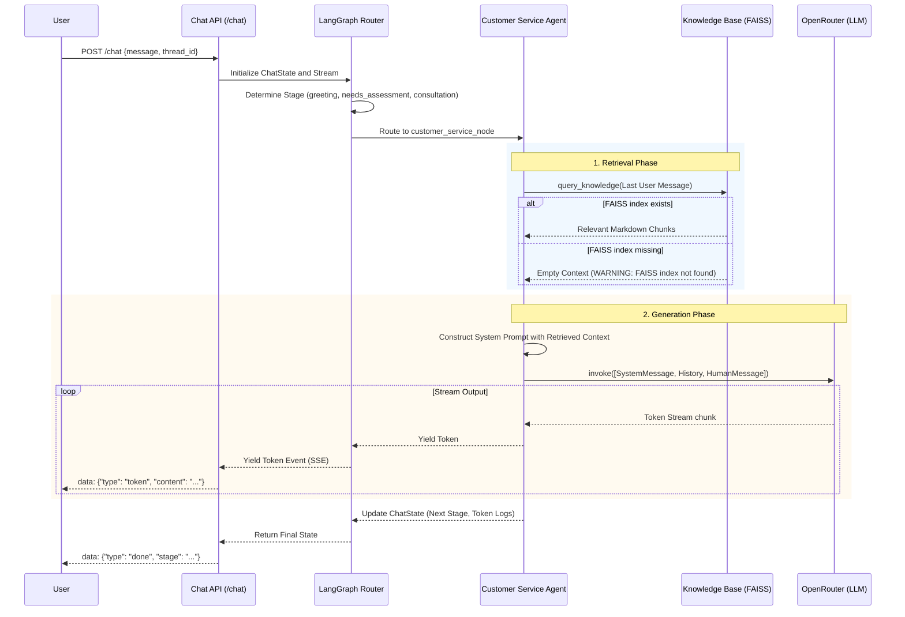

# FAISS Retrieval System

This document explains how the retrieval mechanism works using FAISS (Facebook AI Similarity Search) and how it integrates with the LangGraph state machine to generate an LLM response.

## Architecture Flow

The following sequence diagram illustrates the entire flow from a user message to the final streamed LLM response, including the retrieval step:



## How it Works

### Product Knowledge
1. **Embedding**: Product knowledge (`product_knowledge.py`) is converted into vector chunks using an embedding model via the **OpenRouter API** (e.g., `qwen/qwen3-embedding-4b`). This avoids high memory usage on the local machine.
2. **Indexing**: These vectors are stored in a FAISS index (`data/faiss_index/index.faiss`) for fast similarity search.
3. **Querying (Retrieval)**: When a user asks a question, the query is embedded via the same API, and the most similar vectors are retrieved from the index via `query_knowledge()`. If the index file is missing, it returns an empty context string.
4. **LLM Generation**: The retrieved text chunks are injected into the context variable of the `CUSTOMER_SERVICE_SYSTEM_PROMPT`. The LLM generates a response based on this context.

### Testimonials (Hybrid Mapping)
1. **Semantic Search**: When image intent is detected, the query is embedded and searched against a dedicated testimonial FAISS index (`data/faiss_index/testimonials/index.faiss`).
2. **Database Lookup**: The FAISS index stores the `id` of the testimonial. The system then queries the **PostgreSQL** table `mengantar_test.testimonials` to retrieve the actual `image_path` and `description`.
3. **Fallback Mechanism**: To ensure robustness, if the database retrieval fails, the system can fallback to hardcoded mappings to maintain a functional user experience for core testimonials (e.g., Amanda and Silmi).

## Troubleshooting

### `WARNING - FAISS index not found. Returning empty context.`
This warning occurs because the backend is trying to retrieve context for the user's message, but the local FAISS index files have not been generated yet. 

**Solution**:
The FAISS index is **automatically built** when starting the application via Docker Compose. However, if you are running locally or need to rebuild it manually, you can run the `build_index` function. You can do this by running the following command in the `backend/` directory:

```bash
make build-index
```
Alternatively, you can run the script directly:
```bash
uv run python -m app.rag.knowledge_base
```
Once generated, the files (`index.faiss` and `chunks.pkl`) will be created in the local directory, and the system will successfully retrieve the knowledge chunks on the next chat interaction.
